# 完整財報 RAG：功能流程圖

## 2026-10-29：第四階段每個chunk補齊檔案年度（更正）

使用者更正並確認：不是只有years為空才補，而是只要years不含檔案年度就追加，保留原有年度並排序去重。例如2024_2330的[2022,2023]變成[2022,2023,2024]；已含2024不重複新增。original及parent_child的文字、表格、子項及父項均適用。僅修改metadata，不新增content／embedding前綴；表頭與前置標籤仍照既有規則判讀，再追加檔案年度。補入值代表財報檔案年度，不宣稱是表內期間。

核心為table_metadata.with_document_year，由hierarchical.make_item共用；year_sources保留原來源，原本無年度時記document_year_fallback，有其他年度但缺檔案年度時記document_year_included。parent_child規則5.6、original規則1.4，schema不變。只改程式，不重跑既有chunk或索引；常駐網站重新載入後，新執行第四階段才套用。驗證範圍：檔案年度存在／缺少／重複、保留表頭年度、兩種切法與前處理契約，以及實際2024台積電三種切法的正文與來源不變。


## 2026-10-29：最新四份77題重排報告改名

依使用者要求，舊四索引跑新版77題的最新重排目錄改為 `Output/reponse_rerank/BGE 父子250`、`BGE 原始`、`Voyage 父子250`、`Voyage 原始`。僅移動這四份完成報告，不變更證據、分數、索引或其他歷史資料。網頁報告辨識除既有qa時間名稱外，明確接受這四個名稱，沿用來源目錄與檔案路徑檢查；新執行仍產生qa時間目錄，不覆寫這四份。既有網站程序需重新載入程式才套用辨識規則。


## 2026-10-28：後續四組實驗範圍

既有54組結果 → 按原始完整度收斂 → BGE250 G3、BGE原始 G3、Voyage250 G8、Voyage原始 G2 → 後續依使用者指示進行比較。其餘組別只淘汰後續實驗，不刪索引或歷史測報；未啟動新測試。

## 2026-10-28：單題與測報分開

單題查詢 → 核心檢索／可選重排／回答 → 畫面結果（不寫測報）；Excel批次 → 原有評分與報告輸出。問題向量快取及歷史報告保留。


## 2026-10-28：報告輸出

既有單／多方法評分結果 → 完整result.json先保存 → 九頁精簡作圖Excel（含用途與限制）＋分題重排JSON／回答Markdown → 多索引另存共同題集比較表。離線讀舊報告也可生成九頁表，不呼叫模型；不同版本分群、未執行不假填0。


## 2026-10-28：必要數字唯一評分

既有查詢篩選與召回 → 按必回父項去重 → 跨chunk累積標準數字（不以年度／股號／標題／頁碼擋分） → 各數字組補齊才命中 → 原始等額分數＋補齊名次比例扣分 → 新版numbers-only/1.0報告／曲線。pending不計平均，歷史報告不覆寫。


## 2026-10-28：按自身配分比例排名扣分（已實作）

符合原有命中條件 → 年度×標題各占10/N → 同必回父項去重、取得首次有效名次 → 比理想名次晚一名扣(10/N)/原始K → 逐題原始／加權分數及曲線。新版本3.2／必要數字1.1；舊報告保留原分數，不自動重算。

## 2026-10-28：必要數字測試集已更新

使用者確認補證據章節 → 更新92題Excel（81題ready／11題pending） → pending分數null、不計平均 → 網站重新上傳新版Excel後使用年度×標題＋必要數字規則。原題、答案、年度保留，題庫向量識別與索引不變；目前未啟動新檢索。

## 2026-10-28：年度×標題＋必要數字（判定器已實作，92題標註未全部完成）

Excel讀取Required_Numbers → 核對目標年度／標題定義 → 股號、內容年度及標題符合 → 同一候選具備該目標全部必要數字才命中 → 沿用原始／加權公式與去重 → JSON／Markdown／Excel明示版本及缺漏。必要數字不送模型；有欄但定義不完整不計分；未提供此欄的舊題仍沿用舊規則。完整92題必要數字仍待逐題整理，不將草稿自動當成已確認標準。

## 2026-10-28：不依賴切法的證據清單（草稿已產生，語意標準待確認）

既有逐題離線稽核＋來源chunk → 整理92題必要值分組與來源片段（已實作） → 逐項核對年度／科目／數值／單位／條件（尚未全部完成） → 固定標準事實後比較不同切法Top50（尚未串接）。目前不改原年度×標題評分，不將錨點共現當成正式證據命中。

## 2026-10-28：獨立測試分析報告（已實作）

Excel批次實驗：檢索／父項召回／重排序各自沿用年度×標題原始與排名加權分數 → 新執行另存`測試分析報告.md`及逐題`ID_*.md／json`。舊報告重排序沿用來源檢索分數，只重算重排序階段；正式問答不依賴實驗報告。

## 2026-10-28：標準證據類型（已實作，跨頁待核對）

Excel的`Evidence_Type`及`Cross_Page_Table`隨題目進入實驗報告；前者由使用者提供題號分類，後者在未核對原始表格時保留unknown。兩欄不進向量檢索、Voyage重排或LLM回答的模型輸入，也不影響原評分。詳見[Code_2/QUESTION_BANK.md](Code_2/QUESTION_BANK.md)。

## 2026-10-28：問題向量快取與分題輸出（已實作）

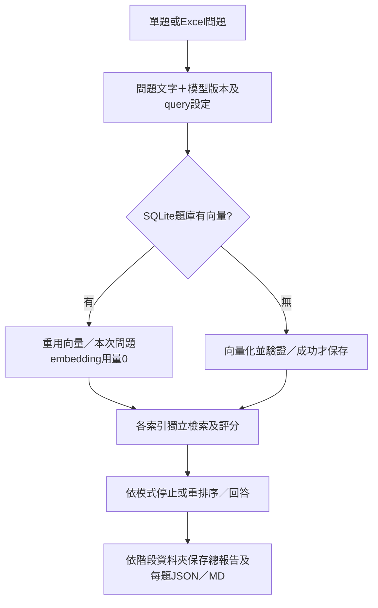

只檢索的分題證據先取TopK子項再合併必回父項，不補選；原始切法不額外召回標題父項。舊報告仍可讀取。詳細限制與驗證見[Code_2/QUESTION_BANK.md](Code_2/QUESTION_BANK.md)。

## 2026-10-27：API金鑰介面簡化為三個用途

依使用者要求，統一網站與Code共用的API設定頁只保留三區：Voyage embedding（voyage-finance-2）、Voyage rerank（沿用已設定模型，預設rerank-3-lite）、LLM（Gemini／OpenAI GPT二選一，明確指定模型ID）。各區只有一個金鑰輸入及儲存／更新、刪除按鈕；移除自訂名稱、共用金鑰選單、模型設定清單及已保存金鑰清單。BGE本機功能仍不需要API金鑰。

manage新增save-slot／delete-slot；api_profiles.json可選slots欄位記錄各用途目前設定或明確清空狀態，不保存密鑰。金鑰仍只存.env。留空保存同服務商現有金鑰；LLM切換服務商時必須輸入對應金鑰。儲存後同用途只顯示目前設定，建庫與問答選單同步更新；刪除已清空的用途不會自動復活舊預設。舊設定保留相容，不自動大量刪除；既有金鑰可直接顯示已設定狀態而不回傳秘密。若舊Voyage金鑰同時供embedding及rerank使用，清除單一用途時保留另一用途仍需的金鑰。外部環境提供的金鑰不假稱能從介面刪除。寫入失敗恢復原.env內容。

驗證：29項暫存假金鑰／本機HTTP測試及Node介面契約檢查通過，含用途相容、替換／保留金鑰、服務商切換、共用舊金鑰刪除、秘密不進回應／JSON與失敗復原。未用真實key呼叫模型，未改現有索引。

## 2026-10-27：批次建立獨立索引（已實作）

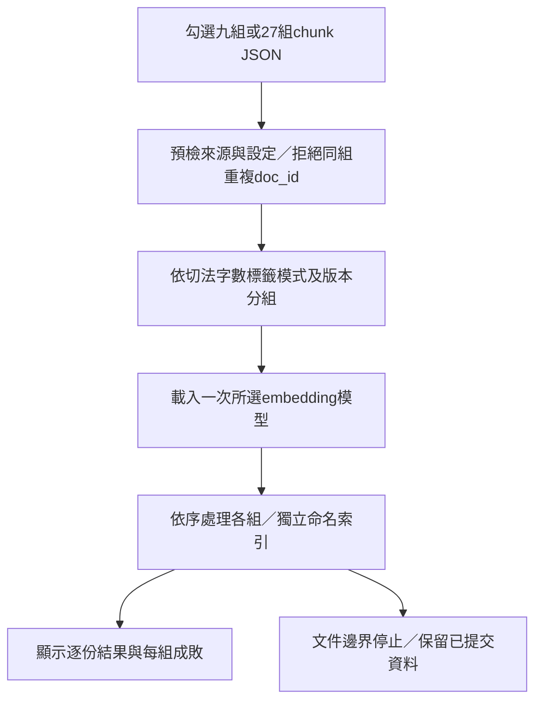

第五階段「索引操作」新增batch／批次建立獨立索引。一次選多份chunk JSON，輸入索引名稱前綴並選一個BGE或Voyage設定。先預檢全部來源，按plan_key（前處理版本、來源規則、完整chunking參數及文字／表格embedding_context_modes）分組，依組順序處理；同組不同doc_id共用索引，同組重複doc_id在載入模型前拒絕。支援九組或27組，不會合併不同脈絡向量。

每組建立獨立隨機experiment ID，顯示名稱為前綴＋G序號＋切法／字數＋文字／表格模式；總長80字時縮短前綴。每次批次執行均為新索引，重跑不自動接續或覆寫舊索引。模型provider在本次工作只建立一次，各組依序使用。保留單一新建與加入既有索引功能；check_only只檢查、不建立集合或匯入紀錄。來源失敗列明錯誤並繼續有效來源，沒有成功文件的集合不當成已提交索引。

介面會顯示預檢進度、目前索引組／總組數、逐份結果及每組完成／部分失敗／未全部執行狀態。原本文件邊界停止功能沿用，停止後保留已提交資料，後續組不執行。選batch時顯示全部切法來源，仍可篩選切法後只勾九份。CLI：Code/vector.py --batch-index-prefix 名稱 --backend bge --source <相對chunk路徑>（可重複指定source）。Voyage仍須明確啟用API。

驗證：34項相關Python測試及Node介面契約檢查通過，使用假向量、暫存Chroma及本機HTTP；涵蓋27組／28份分組、provider僅載入一次、同組文件共用索引、重複防護、API接線、只檢查、錯誤與停止。既有2024年的27份JSON亦核對為27個不同設定。未呼叫真實模型或重建現有索引。

## 2026-10-27：第四階段選擇文字／表格的embedding脈絡（最新）

使用者更正：設定位於第四階段切chunk，original及parent_child均支援。文字與表格各自選body（純正文）、description（正文＋說明）、full（正文＋Sub_Section＋Note_Title＋說明），預設full。完整模式不額外加入Main_Section、年度或股號；原正文及表頭中的年度保留。說明沿用table_context／directions，去掉說明年度並去重。metadata仍完整保存，切分邊界及字數算法不變。

每份chunk JSON新增embedding_context_modes記錄兩項選擇；搜尋chunk及父項各有embedding_context_mode，content_prefix依模式生成，正文保留來源映射。新輸出檔名例如2025_2330_chunk_250_text-body_table-full.json，Markdown及Record同步命名。舊版檔名及沒有模式的新舊schema資料繼續相容；既有Output及索引不自動更動。

第五階段移除脈絡選單，直接沿用chunk設定；不接受建庫請求覆寫。prepare_document、prepared驗證及索引簽章保存模式，加入其他模式索引會拒絕。索引清單顯示文字／表格模式供檢索時選擇。檢索當下無法改變既有向量；要改實驗設定，先重新產生chunk，再建立獨立索引。原本任意欄位角色選擇器仍維持移除。

入口：前處理→第四階段切chunk→文字／表格chunk的embedding脈絡。CLI：Code/main.py --chunk-batch <批次> --text-embedding-mode body|description|full --table-embedding-mode body|description|full。核心為content_context.py及embedding/context_modes.py；未呼叫付費模型或重建既有索引。

## 2026-10-27：移除網頁欄位選擇器

第五階段從統一網站移除「查看／選擇欄位標籤」按鈕、前端腳本及欄位選項API。建庫直接載入`Code/config/embedding_fields.txt`固定欄位用途設定；未改既有索引或其資料。

## 2026-10-27：舊報告先子項重排（取代前節父項先重排順序）

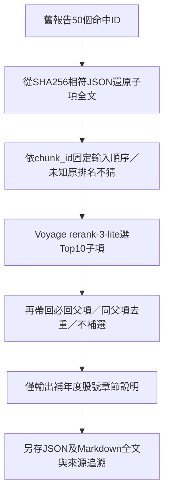

不重查索引、不重新embedding、不生成答案；Top10子項與最終父項證據都保存。四份各118題已授權執行，外部完成狀態以新報告為準；局部假服務與四份來源還原已驗證。

## 2026-10-27：舊報告固定候選重排序（已實作，本機／假服務驗證）

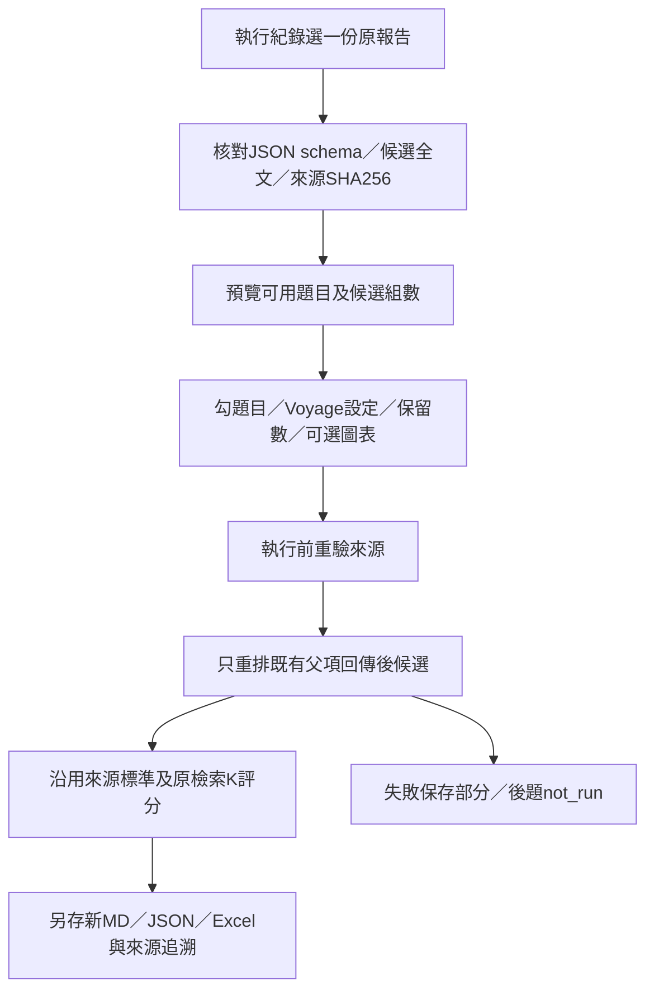

不重新embedding或查向量庫，不生成LLM回答，Answer不送入重排。原報告不覆寫；單題無Excel評分，缺少全文的統計報告不可使用。EvaluationSettings.enabled集中停用。真實API與品質尚未驗證，瀏覽器預覽與假服務完整流程已核對。

## 2026-10-27：命名索引及inspector試驗分支（已實作，局部驗證）

補充本輪完整實檔驗證：2024台積電目錄維持Docling後，查核P4～P7、附註P16～P124共113頁，98.476秒成功輸出，P4／P7回退Docling，來源SHA256不變。完整raw再經processed→tagged→original700（207chunk／14父項）、parent_child250（258／42）、parent_child700（220／33）及建庫前處理全部通過。這是結構／契約驗證，沒有全表逐格人工驗收或真實embedding／LLM。可讀紀錄：Output/pdf_parser_comparison/full_stage1_20261027_122001/validation.md。第一次目錄錯配13頁的產物另存品質失敗紀錄，不當成成功驗收。另12項問答模式及pip check通過，瀏覽器已核對新選單與名稱欄。

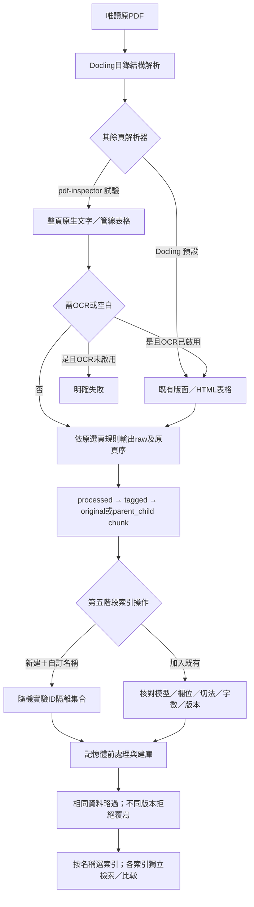

原生文字先快取整份，但只輸出原選定頁；回退沿用現有Docling策略，不保證所有文字都來自OCR。圖中|格式的原始欄列錯誤仍需核對。已做真實P40／57／71局部下游驗證，另已通過上述單份完整第一階段與下游結構驗證；未建真實新索引或測LLM品質；既有索引不搬移、不刪除。

## 2026-10-27：表格民國年度下限100年

使用者確認表格可採113年度、113年12月31日、112年等明列年度，民國未滿100年不列入（100可採，90／99不可）。ROC_YEAR_RANGE集中改為100～288，西元1900～2199與其他格式維持。此限制套用表頭及表格前置標籤的共用年度解析器；小於100不轉換、不補足，1至3年等短期年限不再成為1912／1914。表頭無有效年度時繼續讀範圍內前置標籤，最後才依既有規則使用文件年度；不調整表頭優先順序、不改一般文字年度。

第四階段parent_child規則更新bounded-parent-child/5.4、original更新content-end-original/1.2，schema不變。新規則與舊索引隔離；舊chunk／向量不自動修正。套用既有文件需重跑第四階段，並於第五階段選新版JSON建庫，尚未替使用者執行或重建索引；不需重新OCR。原始chunk_id標註／表格文字命中分析仍暫停。

## 2026-10-27：多標題邊界解析修正

同一Excel格內逗號（含中文逗號／頓號）後接新章節編號時，拆成獨立標題，再依既有規則去掉編號、比對完整名稱。原有分號／換行仍支援；不切開「不動產、廠房及設備」等標題本身的頓號或英文逗號。沒有新編號的含糊字串如「二二、營業收入 、資產總計」保留原樣待確認，不擅自猜成兩個標準。新報告year-title-dual/3.1，舊2.0／3.0報告保持原始解析與分數，事後製圖仍保留來源版本。原測試Excel與歷史Output不改寫，不重跑模型；類型標註功能仍暫停。

## 2026-10-27：跨財報內容年度及無編號標題評分（最新）

使用者確認只要股號、chunk內容年度及標題符合，即使來源為2025財報也可對2024項目得分。Doc_Id僅供股號識別，不再限制來源財報年度；Page只保留覆蓋／缺漏顯示供核對，不再擋得分，Page空白亦可計分。所有要求年度×標題仍分項給分，原始／加權及去重扣分不變；來源索引只預檢是否含該股號，不再因標準財報年份不存在而跳過。標題忽略每層開頭中文／阿拉伯編號及空白、全半形差異，對照Sub_Section或Note_Title各層的完整語意名稱；保留IFRS、指標中的數字及其他語意，不採模糊字串猜測。指定完整多層路徑時仍需整條名稱對上，不能只同上層就算命中。

新報告year-title-dual/3.0；舊2.0報告及其圖表保留舊分數，不暗中重算或改標版本，事後製圖支援2.0／3.0並沿用來源規則。新規則不需重建向量庫，網站閒置時重新啟動後套用。正式檢索問題與API資料傳輸不變，僅調整實驗評分。

使用者同時提出從完整語料找原始chunk_id、勾選確認答案類型以比較表格／文字命中率；已明確要求此部分先暫停。尚未實作候選標註工具、標準答案類型或類型命中率，不以召回結果自行推定標準、不擅自產生確定gold chunk_id，也不改原測試集。


## 2026-10-27：多索引獨立比較與事後製圖（最新）

使用者確認多索引各自執行，不合併證據；事後圖表另存新報告、保留原結果。問答頁勾「複選索引，各自執行並比較」後列出全部已提交集合（模型／切法／字數／文件數），可跨切法選擇；相同問題、篩選、召回與服務設定依序各跑一次，每個集合各自重排序與回答，API成本分別計算。單題及Excel都支援；全部先核對集合，最多20個不重複索引；模型／API或保存失敗後未執行的索引明確標示not_run，不自動重試。各索引各自保存原問答或Excel報告，結果區可切換檢視，各自列平均及可評分題數；原始切法不支援標題父項時，多選共用開關停用。

Excel預設未勾「執行後製作原始／加權圖表與統計表」，未勾不呼叫曲線計算。完成後可按「開始製作圖表並另存統計報告」；只讀既有年度×標題雙分數貢獻與排名，不重查索引、不送問題或候選給模型。已保存者從固定source_run讀取；未保存者只提交精簡分數，不含chunk正文。圖表另存新的qa_時間資料夾：answer.md、result.json、results.xlsx、charts.svg，保留source_run；舊版缺少原始分數報告拒絕假填。已勾執行前製圖或事後製圖完成時，圖表直接展開，仍可取消勾選隱藏。

EXPERIMENT_ONLY：chart_report.py負責來源驗證、曲線及另存圖表統計；make-charts工作與既有evaluation.js入口沿用EvaluationSettings.enabled，移除時刪服務分支及入口；正式單題多索引執行comparison.py不依賴評分模組。原報告不覆寫，原始PDF與向量庫不改動。需網站閒置時重新啟動載入新後端，未替使用者執行真實檢索／API或中止背景建庫。


## 2026-10-27：執行前選擇是否製圖（部分完成，後續待確認）

Excel輸入新增未勾選的「執行後製作原始／加權圖表與統計表」；generate_charts必須為布林值，預設False。未勾選只做檢索／評分與一般保存，不呼叫build_curves，勾選才產生原始／加權曲線及統計。

使用者另要求查詢／回答可複選向量索引一次跑完，以及未先製圖時可在結果旁事後製圖。待確認多索引獨立結果或合併證據、事後圖表是否另存報告；這些部分尚未完成，不把草案當作實作。背景建庫不停止、不重啟。

## 2026-10-27：結果圖表改為勾選顯示

批次結果預設呈現檢索／逐題結果，曲線區新增「顯示圖表與統計表」未勾選核取方塊；勾選後才建立原始／排名加權折線、逐K表及5筆區塊分析，取消即隱藏，再勾不重複建立。每次呈現新結果預設不勾選；無曲線的舊報告不顯示空控制。此選項只控制畫面，既有計分、平均及Excel／Markdown匯出不變。EXPERIMENT_ONLY沿用evaluation.js與集中停用設定。

## 2026-10-27：年度×標題雙分數（最新，取代僅標題計分）

使用者最終確認兩年度、兩標題拆成4個給分項目，每項2.5分；單個chunk可同時滿足多年度與標題。原始分數=10×已命中組合數／總組合數，部分命中按比例；排名加權則同組合各占10/N，依各組合首次有效排名及既有理想排名扣10/retrieve_k。年度以chunk.years確認，Years空白不猜年度而每標題一項；查詢Years仍採OR，完整度由評分逐項核對。文件／同chunk標準頁碼、Sub_Section或Note_Title比對、必回父項去重維持；不額外放寬文件與頁碼。

新報告year-title-dual/2.0，score及mean_score保留為加權相容欄，另外保存raw_score、weighted_score及各自平均、年度×標題命中數、缺項與Top。原始曲線raw_curves用於觀察召回到幾段，加權curves用於切法比較；兩種皆固定同批可評分題、分階段呈現、含逐K及每5筆區塊表。網頁原始／加權各有獨立折線圖，Excel各有曲線與區塊工作表，Markdown兩套數據亦保留。不重新計算歷史報告、不呼叫API或重建向量；閒置時重啟網站後新批次套用。

## 2026-10-27：累積平均得分折線圖與區塊分析

已確認固定以原始retrieve_k決定扣分，僅改變取前K筆的截點；Top50時畫有效Top1～50，全部固定每名扣0.2。同必回父項去重沿用，三階段分開，曲線固定同一批可評分題數，0分計入、失敗與無法評分不計。每5筆統計增分（最後不足5筆仍保留），標出增分最多區塊及首次達本次完整平均分的最小K；全零不建議截點。這是同次候選截取分析，不代表重新呼叫模型的品質或耗時測量，也不宣稱跨測試集最優。

EXPERIMENT_ONLY模組eval_curve.py由eval_run.py在匯出前呼叫；網頁evaluation.js以SVG畫折線及表格，JSON存curves，Markdown與Excel新增各階段曲線／區塊表。正式停用沿用EvaluationSettings.enabled，無新增依賴、無額外API呼叫，舊報告不回填。重啟網站後新批次產生曲線。

## 2026-10-27：依向量召回數調整評分（最新）

使用者指定每名扣分為10/K，K採向量檢索設定retrieve_k，而非實際回傳數或重排序保留數；Top50扣0.2、Top20扣0.5。有效評分範圍隨K，不再固定20；去重、多標題10/N與理想排名、同chunk文件／年度／頁碼及跨層級標題條件維持。重排序階段沿用檢索K。網頁／Markdown可讀全部評分候選，Excel保留前20個chunk_id欄及完整命中排名／缺漏與分數。新報告page-title-rank/1.2，舊報告不改寫；重啟網站後套用。

## 2026-10-27：批次平均得分

測試結果畫面顯示平均得分及計入題數；Markdown報告同步顯示，Excel新增「總覽」工作表保存數值型平均與題數。沿用每題最終評分階段的平均，0分題計入；失敗、未執行、缺語料或無法評分題不計入，沒有可評分題時顯示無法計分。既有報告不覆寫。

## 2026-10-27：測試標題跨層級比對（最新）

使用者確認：Excel的Evidence_Note_Title對照同一chunk的sub_section或note_title，任一欄位在忽略空白及全半形差異後完整相符即可；不讀Evidence_Sub_Section作判斷，也不增加Main_Section比對。文件、年度與至少一個標準頁碼仍須在該chunk符合，去重及排名扣分不變。同一目標出現在兩欄只算一次。新報告scoring_rule為page-title-rank/1.1；既有報告保留當時規則與分數，不自動覆寫。程式更新後需於網站閒置時重啟，讓後續測試載入新規則。


## 2026-10-27：建庫安全停止（新工作已實作）

建庫開始 → 產生本批控制ID → 每份開始前讀停止設定 → 執行當前文件完整embedding與提交 → 記錄結果 → 是否已達停止位置 → 是則stopped並列後續未執行；否則下一份。可選「完成目前文件」或「完成指定文件」。不強制終止持久索引；前四階段立即取消保持獨立。舊版正在進行的批次不能熱載入此功能，需完成後重啟網站。

## 2026-10-27：Excel批次測試（已實作，未跑真實模型評估）

同站上傳xlsx → 工作表／題目勾選與參考資料預覽 → Question查詢、可選股號與Years OR篩選 → 原始檢索 → 必回／可選父項 → 可選重排序／回答 → 獨立實驗評分（同chunk需含標準頁與Note_Title，年度及文件須符合；不比較Main／Sub）→ 每題一欄xlsx＋Markdown＋JSON。模型只接Question與實際檢索證據，參考答案不輸入；評分去重後前20、每標題10/N且較理想名次每晚一名扣0.5。三階段分開報告命中／缺漏、Top、tokens與耗時。EvaluationSettings.enabled=False阻擋全部實驗入口，一般問答仍可執行。

## 2026-10-27：Excel最新評分規劃（未實作）

Excel輸入 → 可選股號與年度OR篩選 → 既有檢索／可選重排序 → 同父項重複子項不佔有效排名 → 頁碼與Note_Title找到／總數及缺項 → 每標題10/N分、較理想位置每晚一名扣0.5。Main_Section／Sub_Section不作評分條件；標題與頁碼是否必須同chunk仍待確認，不把規劃當作已有功能。token及耗時顯示需求已確認。

## 2026-10-26：Excel批次測試規劃（未實作）

Excel → 驗證ID／Question → Question作查詢、Doc_Id抽股號／Years多年度OR作可選篩選 → 既有檢索／可選重排序 → Excel證據欄位對照實際chunk來源（Page直接對chunk.page，文件身分一起核對）→ 評分及報告方案待確認。Answer及標準證據不送進模型；分開評估子項與父項召回的方案尚待確認，不能當作完成的批次功能。

## 2026-10-26：父子檔名附字數（已實作）

parent_child字數設定 → 第四階段_chunk_700.json／.md（依實際設定變更後綴）與獨立Record → 第五階段核對後綴與JSON切分設定 → 既有模型＋模式＋字數＋規則索引簽章 → 分開的Chroma集合 → 問答選擇單一集合檢索。底層儲存目錄可共用，集合不混用。original／doc_id不改名，舊檔繼續可讀，既有產物與索引不改寫。常駐網站重啟才載入新清單規則。

## 2026-10-26：第一階段恢復HTML（最新已實作）

PDF → 既有OCR／版面／accurate表格結構辨識 → HTMLTableSerializer → Markdown正文內嵌HTML表格（保留rowspan／colspan、表題及表下注）。CPU8／批次1不變，取代先前預設管線表格的決定。下一次第一階段worker讀取設定，既有來源不改寫。第四階段content_start／content_end只控制切分，不進入chunk或父項正文。

## 2026-10-26：parent_child相鄰內文先合併（最新已實作）

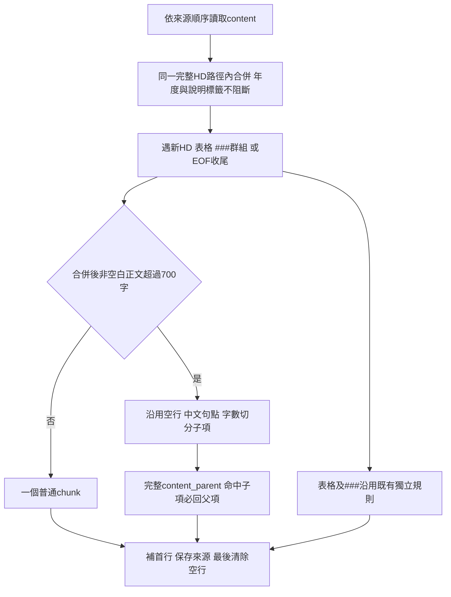

完整路徑含標題位置，不合併不同位置的同名標題。可選heading_parent與必回content／table_parent分開；original及會計師查核報告例外不變。規則bounded-parent-child/5.3與舊索引隔離，舊產物不改寫；需重跑第四階段及新建第五階段索引才在檢索套用。

## 2026-10-26：第一階段表格輸出更新

PDF → 既有OCR／版面／accurate表格結構辨識 → Docling MarkdownTableSerializer → 「|」管線表格與表題／表下注。CPU 8、批次1不變；合併儲存格展平警告保留，既有產物不改寫。


## 2026-10-26：original父項例外修正（最新）

original一般文字→依content_end門檻成獨立chunk，不建content／heading父項；跨頁表格→table_parent，###→沿用特殊群組父子規則。補Sub_Section／Note_Title／說明首行不建立父項。parent_child不變。original新規則1.1隔離舊1.0索引，舊資料不改寫。


## 2026-10-26：original一般文字切分（最新）

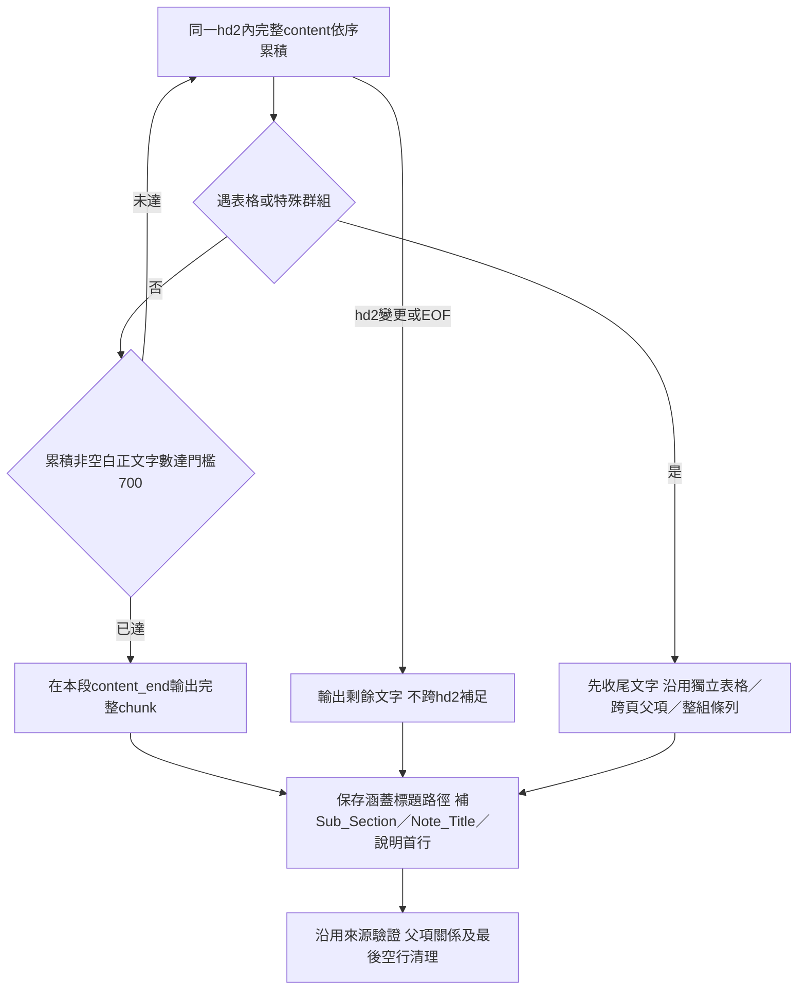

hd3以下不提早截斷一般文字；單一content超700仍整段保留，不因字數建立內文父子。original規則content-end-original/1.0，schema5.0；parent_child保持原切法，其他規則共用。既有產物與索引不改寫。


## 2026-10-26：chunk首行縮減（最新）

第三階段標籤與metadata → 第四階段parent_child只生成Sub_Section／Note_Title／說明首行（空欄省略）→ 年度、股票代號及main_section保留於metadata → 第五階段與Code_2不重新補回首行。正文與表頭原有文字保留，original不變，舊產物可讀；新版規則5.2隔離索引。本輪未重寫Output或重建索引。


## 2026-10-26：統一網站（已實作）

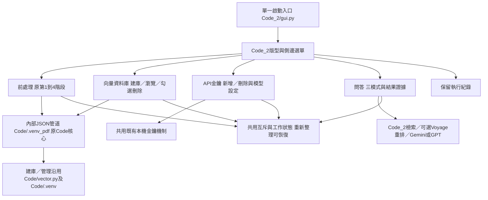

同一HTTP站與來源，不需再手動啟動第二站；核心及兩個Python環境保留。舊啟動器轉至統一入口。現有索引／Output不改寫；本輪無真實模型／API品質驗收。


## 2026-10-26：樹狀資料庫管理與損壞集合移除

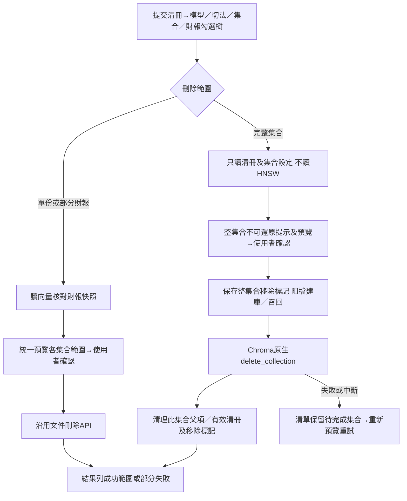

跨集合依序處理，不宣稱原子或可回復；只實作功能，未代刪使用者真實集合。


## 2026-10-26：每階段的單檔執行摘要

第一至第五階段逐檔執行 → 沿用核心耗時／例外補計時 → 結果顯示執行時間及本次CPU／批次設定（不適用者明示）→ 沿用各階段Record或建庫清冊保存。此摘要不參與embedding或問答證據；失敗也顯示，不改寫歷史紀錄。


## 2026-10-26：第四階段最後清除空行

既有切分／父子分組 → content首行生成及原始完整性驗證 → 搜尋chunk移除空白行 → 由清理後子項重建完整父項 → 更新來源映射、記錄removed_blank_line_spans並驗證 → JSON／Markdown輸出。兩種模式皆適用；前面的空行切分判斷保持。


## 2026-10-26：第四階段5.0與兩類父項回傳（目前實作）

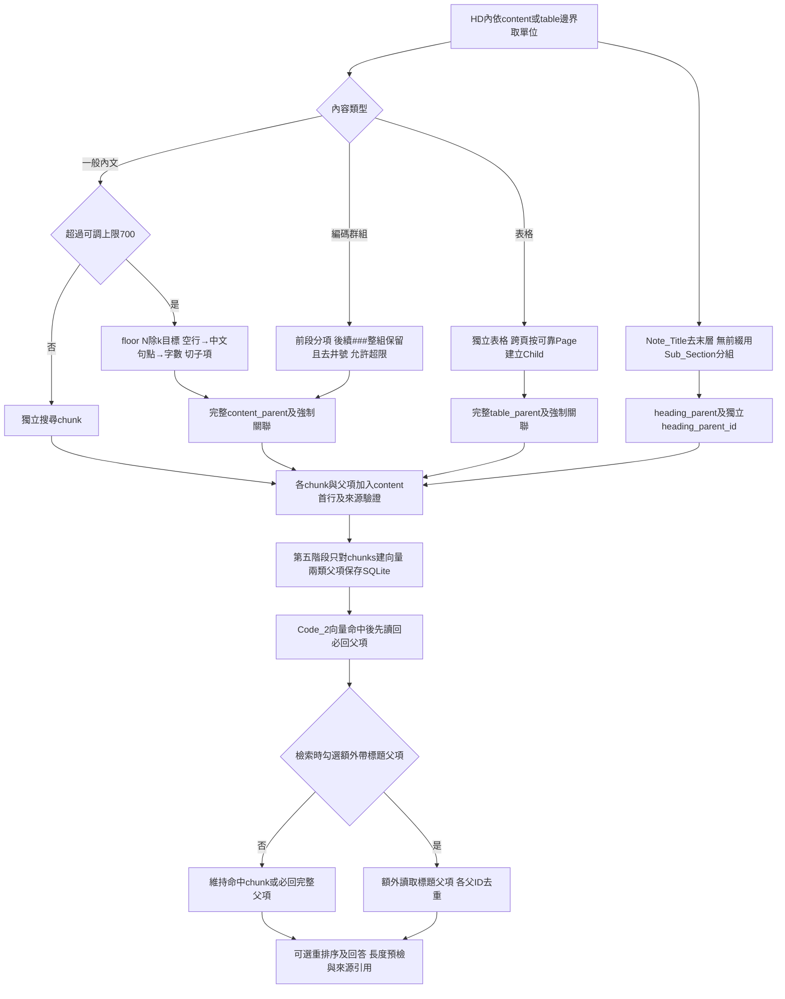

階段四不設定召回開關；original維持4.0，新parent_child為5.0。###群組依使用者再次確認允許超過700，普通前段仍按上限切；表格獨立優先。頁界不可靠時保留完整內容並記錄issues，不猜拆表格。Code相關114項＋HTTP7項、Code_2全套140項及Node兩項測試通過；真實樣本與限制見Code/maintenance/parent_child_v5_validation.md。此節取代下方新切分／標題召回未完成的歷史狀態；不代表真實模型品質已驗收。

## 2026-10-26：第二階段候選內空白清理（已實作）

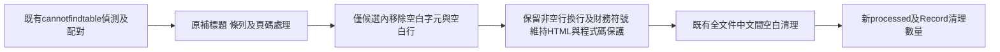

偵測及來源行號計算不變；不新增中間檔案。35項相關測試通過及2024_2303 raw唯讀記憶體驗證完成；舊批次測試另有過時入口／路徑錯誤，未宣稱全套通過。既有Output／索引未改。第四階段新700字切分、表格獨立／跨頁按頁子項、###整組及標題父項／可選召回仍未完成。

## 2026-10-26：parent_child的content首行（目前實作）

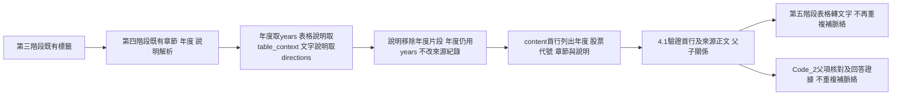

此流程不變更既有年度／說明回查；table_direction可同時供年度及說明，table_year不作說明。original維持4.0；既有Output和索引不自動改寫。本次117項局部測試與2025_2330記憶體來源核對通過，沒有模型API驗證。此節只完成content首行及下游相容，下方新700字切分與標題父項召回開關仍待實作；首行metadata及###整組切法不再是待確認項目。

最新補充：說明移除年度已實作，來源規則4.2-context、schema維持4.1；表頭年度優先保留。只移除生成首行的明列年度，不改金額／百分比／期間及來源原文，日期保留月日。120項相關測試與2025_2330記憶體來源核對通過，未呼叫API或寫既有Output／索引。新切分、###整組與標題父項召回等先前需求仍未完成。

## 2026-10-26：第三階段恢復結構收尾（已實作）

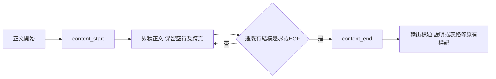

tagging版本3.3；不再按段落空行關閉content，取代歷史3.2。第四階段判斷與格式未改，但輸入content邊界變少可能令文字atom／chunk變大；跨頁表格按頁Child及混合chunk包裝問題尚未修復。既有Output不覆寫，需重新執行第三階段後才能取得新邊界。

## 2026-10-26：第二階段中文字符間空白清理（已加入程式，未驗證）

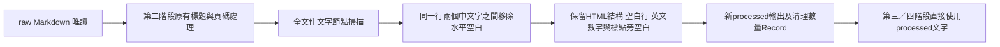

沒有刪除HTML表格空儲存格或任何欄位；後續階段不重做此項正規化。程式已改，尚未跑測試、真實文件或重產生既有Output。

## 2026-10-26：第四階段新切分規則（需求已確認，尚未實作）

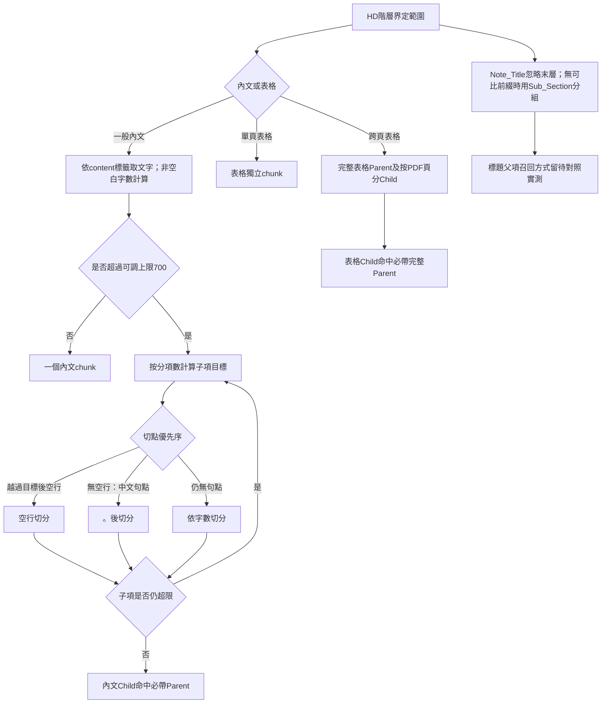

內文與表格父子召回必須可和標題階層召回區分；區分欄位／切換介面、original與parent_child模式如何套用、Markdown第一行metadata欄位仍待確認。圖中為已確認需求及待定項目的流程摘要，不代表程式或檢索已實作；現有4.0程式、Output及索引尚未變更。

新規則僅適用`parent_child`；`original`沿用既有模式。Code_2需要可切換標題子項命中時是否帶回標題Parent，內文與跨頁表格Child固定帶回Parent。內文含`###`時，標記前內容與後續數字編碼項目分為不同Child，輸出content移除`###`本身並保留條目文字；第二階段建立的標籤及Page標記不複製至content，分別由chunk結構欄位／page欄位表達。`###`多次出現／項目缺失邊界，以及chunk第一行顯示metadata仍待確認。程式與索引尚未更新。

## 2026-10-26：共用API設定與可略過重排序（目前實作）

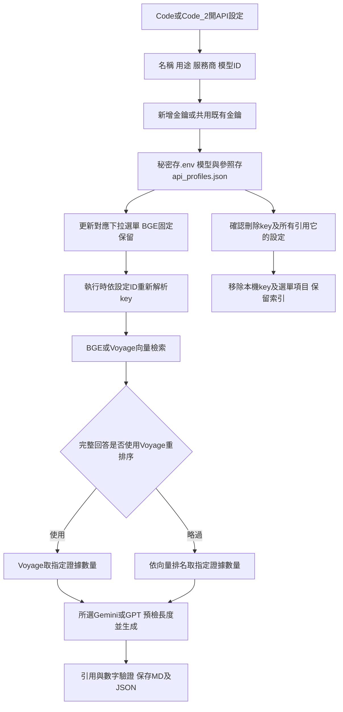

不新增BGE重排序；三模式保留。API key不能決定模型，GPT模型ID由使用者填入；新增設定不自動連線驗證。外部環境key須從啟動環境刪除，不能假稱子程序已永久移除。下方舊固定Gemini／必經重排的流程由本節補充。

## 第五階段與資料管理（2026-10-25最新實作）

本節取代下方歷史Code_2前處理／建庫入口；前四階段流程不變。

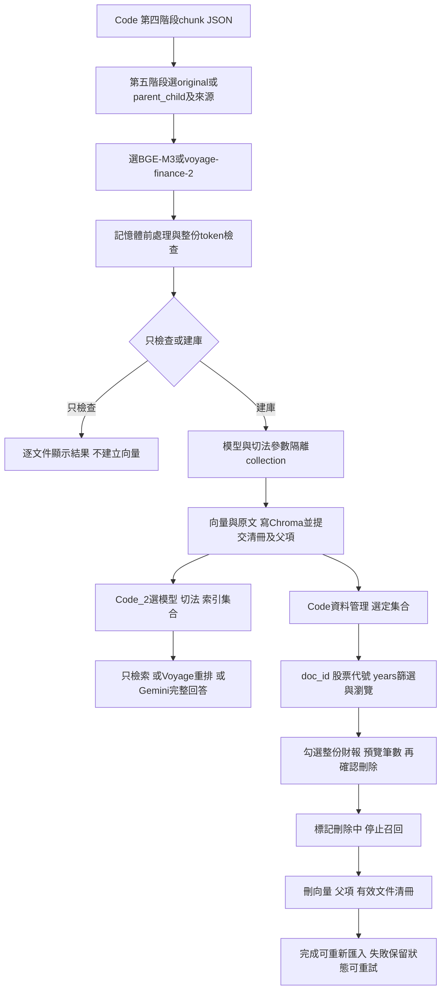

第五階段不產生prepared檔；資料庫及必要清冊仍持久保存。原始PDF、Output、其他索引不受資料刪除影響。新流程已實作，真實模型及API品質未以此流程圖宣稱驗收。

2026-10-25介面更新（已實作）：選階段→只顯示適用操作→選檔及模式→視需要展開進階設定→執行時顯示取消及進度→完成後顯示該階段輸出。網頁OCR預設開，第二／三階段不顯示OCR或切塊設定；第四階段參數順序Parent、一般門檻、Child，滑桿及數字雙向同步。滑桿上限不限制手動輸入，核心流程與輸出命名不變。

2026-10-25命名補充：第一階段亦使用`Financial_raw_日期_時間`；四階段均有階段名稱。同次檔案共用批次，內容流程不變，新舊批次均可讀。

## 2026-10-25：每次執行的新輸出批次


適用第二至第四階段；不同來源資料夾的文件也共用本次新批次。Record分別保留來源與輸出批次，重跑建立新時間批次、不覆寫舊成果；取消只清理本次未完成輸出。第四階段模式子目錄不變，先前沿用來源批次的描述屬歷史。

## 2026-10-25：第四階段雙模式4.0（目前實作）

本節取代下方兩模式／B方案待實作草案；前3階段不變。

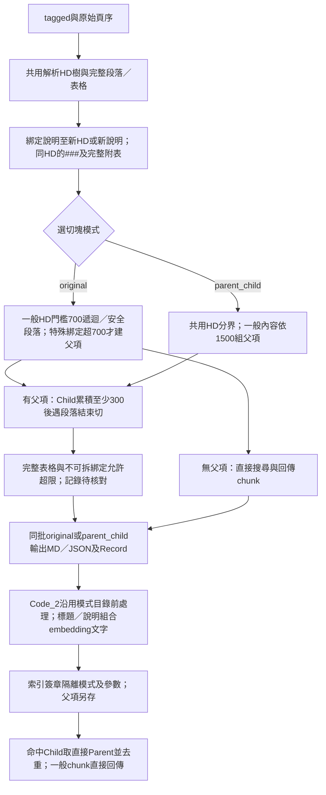

HD／table_year／方向標籤移至metadata，原始表格及數值保存；years既有規則維持。查核仍一##一塊。235項相關局部測試及既有2024_2330記憶體驗證通過；真實embedding／API及索引尚未重跑，不將本圖當成檢索品質已驗收。不可拆超限及未綁定結構標記須人工核對，詳見README最新節。

2026-10-25共用語意綁定方案（B已確認，待實作）：content_direction→收集後續各段正文→遇下一個HD／新的說明標籤／文件結束收尾。空行、content_end與換頁不解除綁定；300字後content_end只作搜尋Child切點，不能改變完整綁定範圍。核心程式尚未接入此新規則，不標為已完成。

2026-10-25新切塊方案（待實作）：共用解析與完整語意區塊→兩模式各自規劃回傳範圍及搜尋單位。Child已確認為「累積至少300字→遇下一個content_end才切」，取代先前500字提案，並非硬切300字；表格及不可拆分綁定例外保留。###同最近標題群組已確認包含中間表格。700字HD遞迴／1500字Parent及兩模式尚未接入程式，現有規則3.3、Output及索引維持，不將方案討論標成完成。

2026-10-25tagged3.2已實作：一般正文→遇空行也輸出content_end→保留空行→下一段正文再content_start。表格及保護區內空行不處理，換頁本身仍不截斷，其他條件維持。第四階段沿原規則使用新的正文結束位置；92項局部測試通過，既有Output未更新。

2026-10-25新增已確認需求／待開發：第四階段以兩個互斥模式按鈕切換「目前切法」與「父子標題切法」。前者已實作，後者的父子邊界尚待確認，介面切換亦未實作，不能將建議方案標為完成。

2026-10-25切分規則3.3：表格父項／按頁子塊→各自檢查content是否含cannotfindtable標記→有則table_completeness=0、無則=1→JSON及Markdown保存→Code_2選用metadata相容。純文字無此欄，1不代表人工驗證正確。原切法及年度流程不變，未重建索引。

## 2026-10-25：第四階段表格年度／脈絡已實作（規則3.2）

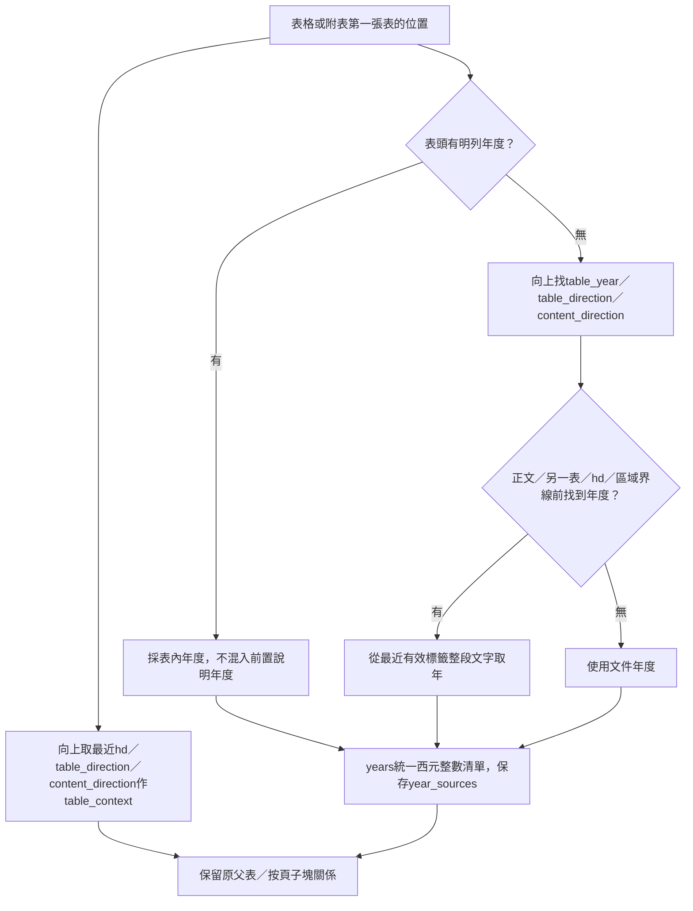

85項局部測試及2024_2330記憶體串接通過，既有Output及索引未更新。Note_Title僅含hd2以下動態路徑，不新增額外階層欄。第二文字切法與疑似表格專門切法仍待需求。本節取代下方年度／脈絡待討論狀態。

2026-10-25chunk3.1章節欄位已實作：區域標記→main_section；查核##／附註hd2→sub_section；實際動態樹葉路徑→note_title清單（查核[]）→Markdown逐行Note_Title，以>顯示階層。同層不串連，無標題不補造。Code_2驗證及metadata相容，未重建索引；額外階層欄位、新年度／脈絡及第二切法仍待討論。

2026-10-25chunk3.0已實作：不再篩公司沿革起點→依原標記分區→查核##一標題一chunk／附註沿原切法→保留來源與可空標題。新Main_Section／Sub_Section／Note_Title欄位呈現與多路徑格式尚待確認，表格年度／脈絡與第二切法不標完成。Output未重產生。

2026-10-25第四階段規劃調整（待完成）：使用者要求將起點由公司沿革改為涵蓋查核報告，並加入Main_Section／Sub_Section／Note_Title；無hd2的空值契約尚待確認，起點限制尚未改。已實作文字chunk也顯示可空的parent_id／part_index，其他新欄位及新切法不標為完成。

2026-10-25tagged3.1：第三階段發現有效cannotfindtable→關閉正文→fulltablestart→保留候選標記與原文→table_end；普通表格仍table_start。沿用頁面／接續詞／附表邊界；第四階段先格式相容，特殊chunk策略待使用者之後說明。

## 2026-10-25：第三階段改用正文分類（已實作）

```mermaid
flowchart LR
    VA[第二階段末段：移除##數字標題的-前綴] --> VB[processed：核對Page與保護邊界]
    VB --> VC[##純年度／日期→table_year]
    VB --> VD[##多年度說明→table_direction]
    VB --> VE[##中文頓號→hd2；其他編號→動態hd]
    VB --> VF[其他##冒號說明→content_direction]
    VC --> VG[保留頁序／控制標記，包正文與表格區塊]
    VD --> VG
    VE --> VG
    VF --> VG
    VG --> VH[tagged；不讀目錄、不產生MAIN_TITLE]
```

編號與冒號同時符合時編號優先。第四階段先相容保存新標籤，不新增年度推算／表格脈絡綁定；仍從公司沿革hd2開始。既有Output未重產生，下方目錄／備援大標圖屬歷史。

2026-10-25標題1.14：第二階段條列###分類後→重查未標記的- 1.類行，符合既有條件才補##→清頁尾；已有井號及保護區維持，僅note後適用。

2026-10-25標題1.13：第二階段note後、保護區外，忽略空白比對行首附表＋中文編號→####；註＋中文編號→###，原文保留。第三階段保留標記；第四階段與跨頁接表同步相容附表####／舊#，不同附表仍分開。

2026-10-25空白辨識更新：第二階段附表前綴忽略空白→單一#；編號標題內容以非空白字元核對20字上限；既有井號後無空格也辨識。頁尾清理接受拆開的數字，純數字仍須最後非空白行且等於原PDF頁序。Page／控制標記／行首縮排及處理順序不變，Output未重產生。

## 2026-10-25：條列分類（body-lists/1.0，已實作）

```mermaid
flowchart LR
    LA[note後：疑似表格及補標題完成] --> LB[從非##內文找數字／英文編號]
    LB --> LC[核對同型相鄰或首項前冒號標題]
    LC --> LD[特殊回查：首項／中間漏項／末項的##]
    LD --> LE[成立項目改###；缺號記錄不補造]
    LE --> LF[清理頁尾頁碼]
```

表格／cannotfindtable／頁序與控制區維持邊界，不跳過表格續找；整組##不主動分類。原文保留，既有Output未重產生。

2026-10-25疑似表格1.1取代下方1.0的純數值計數：note後→先檢查既有保護邊界→忽略空白行→20個中文字以下文字／數字／金額碎片均計候選→連續5行包cannotfindtable→連續3個超過20中文字的正文行或保護邊界結束。觸發前長正文重設計數，不重組金額、不改原文。

2026-10-25標題1.11：第二階段編號比對忽略排版空白→映回原文取得編號後內容→依原字數／句尾規則補##；原文空白與note／表格保護保持。

2026-10-25標題1.10：note後保護區外，純數值／金額／百分比先排除標題（已有##移除），再判年度／多年度＋說明及其他編號。多年度＋說明無冒號也加##、不限字數；疑似表格偵測順序不變。

2026-10-25標題1.9：整行年度及整行年月日皆標##，例如112 年 12 月 31 日；只在note後且不在表格／疑似表格保護區內處理。

## 2026-10-25：第二階段疑似漏辨識表格（已實作）

```mermaid
flowchart LR
    UA[note後raw文字] --> UB[排除已有表格與##等保護邊界]
    UB --> UC[忽略空行；短文字重設數值計數]
    UC --> UD{連續5個數值行}
    UD -->|是| UE[包含前方短項目；開始疑似區塊]
    UE --> UF[3行各超過20中文字或遇保護邊界停止]
    UF --> UG[加cannotfindtable成對標記；原文保護]
    UD -->|否| UH[維持一般文字]
    UG --> UI[其餘文字補標題及清頁碼；processed與Record]
    UH --> UI
```

只標候選，未重建欄列；回PDF／LLM及下游特殊處理仍為後續規劃。舊Output不自動更新。

第一階段選頁1.1（2026-10-24，已實作）：搜尋字串先NFKC及去空白，原文不改。

```mermaid
flowchart LR
    S1[本機目錄頁碼定位] --> S2{附註起頁是否明確}
    S2 -->|是| S5[保留原PDF頁序轉換]
    S2 -->|否| S3[目錄及已知查核範圍後逐頁查公司沿革或獨立附註主標]
    S3 -->|排除引用與保護區後命中| S5
    S3 -->|未命中| S4[停止並記錄定位失敗]
```

真實2021聯電P2／P14局部驗證通過，該份整份轉換尚未重跑；第3層章節組合備援未實作。

第二階段1.8：冒號往前收集新增中文句號邊界，同行也分開，前句保留，僅句號後內容成##；ASCII編號／小數點不受影響。

第二階段1.7：冒號收集新增編號項目邊界，不跨上一項；本項換行仍可合併。整份文件空白清理尚待確認表格範圍，未實作。

2026-10-24最新：第一階段預設表格已依使用者要求回復HTML；管線讀取相容保留。

第二階段範圍（note-only/1.0，已實作）：先找唯一有效獨立note，所有修改只限標記後；缺失／重複時停止該份。

```mermaid
flowchart LR
    NA[raw Markdown] --> NB{唯一有效note標記}
    NB -->|缺失或重複| NC[失敗Record；不產生processed]
    NB -->|存在| ND[前綴及note原樣保留]
    ND --> NE[僅附註套標題及頁尾清理]
    NE --> NF[接回前綴；輸出processed與Record]
```

第二階段1.6最新：純年度行也統一##，取代舊####規則；年度加說明的冒號段落仍合併一行加##。

第二階段1.5（2026-10-24）：冒號結尾段落合併一行加##；英文編號不限長度、保留非空與句尾標點排除；數字／中文維持原限制。已實作，舊Output不自動更新。

```mermaid
flowchart LR
    CA[讀取raw並保護表格及頁序] --> CB[行尾冒號向前收集同段文字]
    CB --> CC[遇空白行或保護邊界停止；不跨編號項或中文句號]
    CC --> CD[合併一行加雙井號]
    CD --> CE[英文編號不限長度；數字中文沿舊限制；保留標點排除及頁尾清理1.1]
    CE --> CF[processed與Record]
```

2026-10-24環境分工：Code四階段CLI／網頁worker使用Code/.venv_pdf，Code_2沿用Code/.venv；資料流不變。PDF依賴隔離不代表Code_2原套件封鎖已修復，詳見Code/README。

## 2026-10-24：第一階段新輸出

```mermaid
flowchart LR
    A[只辨識第2、3頁目錄] --> B[定位查核報告及附註範圍]
    B --> C[Docling轉查核報告及附註；不保留封面]
    C --> D[表格輸出HTML；保留原PDF頁序]
    D --> E[查核首頁前加會計師查核報告標籤]
    E --> F[附註首頁前加note及合併財務報告附註標籤]
    F --> G[processed保護表格；tagged包邊界；chunk父子表]
```

本節取代下方首頁保留與HTML限定的歷史流程；未變更MAIN_TITLE或chunk納入範圍，尚未用真實模型驗證新輸出。

## 2026-10-24：第二階段標題分類

processed並清除獨立橫線頁碼，以及每頁最後非空白行、純數字且符合PDF實體頁序的頁尾；表格／程式碼／註解與Page標記保留（清理1.1）。

```mermaid
flowchart LR
    A[raw Markdown] --> B[保護表格、程式碼與註解]
    B --> C[附表行補單一#；純年度行補##]
    C --> D[一般無編號##退回正文；原編號補##規則保留]
    D --> E[processed]
    E --> F[tagged保留附表與年度標記；原編號轉hd]
```

已實作；未擴充英文編號、相鄰條列排除或表格脈絡綁定。下方2.9附表在tagged補#是歷史流程。

需求與決策以 [USER_STORIES.md](USER_STORIES.md) 為準，AI 規範見 [AGENTS.md](AGENTS.md)，操作及驗證紀錄見 [Code/README.md](Code/README.md)。

目前是實驗階段。流程圖以功能步驟為主；箭頭表示規劃中的資料流，不代表所有步驟已完成，也不代表已核准執行後續實作。

## Code四階段資料夾選取（2026-10-23；已實作，瀏覽器視覺待核對）

```mermaid
flowchart LR
    A[資料夾放入既有階段來源目錄] --> B[遞迴列出本階段來源檔案]
    B --> C[展開逐檔勾選；或勾資料夾含所有子資料夾]
    C --> D[核對白名單與同批輸出撞名]
    D --> E[只把所選檔案交給既有階段核心]
    E --> F[沿用批次及檔名；顯示逐檔進度與結果]
```

後三階段仍以合法Financial批次作輸出對應，Record不列為來源；此功能沒有擴及Code_2或任意外部資料夾匯入。

## 標題與附表規則追加（2026-10-23）

```mermaid
flowchart LR
    A[raw] --> B[processed：符合編號規則就補##，含冒號結尾]
    B --> C[tagged：既有##轉hd；行首附表中文編號標單一#，不限字數]
    C --> D[同一附表的表格、說明與單位歸完整父項]
    D --> E[按可靠PDF頁序產生子塊；無邊界則保留並回報]
    E --> F[years：表格明列年度；文字或表格無年度用文件年]
    F --> G[子塊embedding；完整父項存資料庫]
    G --> H[years包含指定年度篩選；命中子塊取完整父項並去重]
```

上述流程已實作並做本機／暫存Chroma測試；2330與2379既有processed在記憶體串接通過、HTML逐字保留。新格式正式索引尚未實際建立；真實年度辨識、接表語意及檢索品質待核對。table_context是前置標題檢索脈絡，不是正式表名。

## 本機目錄選頁流程（2026-10-23；程式已改，真實轉換待驗證）

```mermaid
flowchart TD
    A[PDF 第一頁保留] --> B[本機辨識第2頁及可能的第3頁目錄]
    B --> C[由目錄找查核報告與附註起頁]
    C -->|附註頁缺失| D[目錄之後尋找正文首次公司沿革]
    C -->|查核報告頁缺失| E[正文報告標題至資產負債表前；再以四大名稱核對連續頁]
    C --> F[只輸出首頁、查核報告及附註至最後]
    D --> F
    E --> F
    B -->|必要文字無法辨識且OCR關閉| G[停止該份並回報]
    D -->|仍無法定位| G
    E -->|仍無法定位| G
```

此圖描述新程式的預期流程，已用兩份既有 raw 模擬核對；真實分段 Docling／OCR 尚未執行。下方 Gemini 圖為歷史紀錄，不是現行入口。

## 階段交接與核對（2026-10-23）

```mermaid
flowchart LR
    A[raw Markdown／頁序] --> B[processed 補標題與清頁碼]
    B --> C[tagged 標籤]
    C --> D[chunk Markdown／JSON]
    D --> E[prepared JSON]
    E --> F[向量建庫]
    R[各階段 Record] -. 執行狀態與來源核對 .-> B
    R -. 缺失或不一致記為待查 .-> C
    R -. 不作為唯一通行證 .-> D
    R -. 不作為唯一通行證 .-> E
    R -. 不作為唯一通行證 .-> F
```

舊 raw 沒有 `selection` 仍可進 processed，但標記來源未經新版選頁。各階段仍檢查實際資料格式、識別、頁序及必要欄位；本圖不表示缺少有效資料也會繼續。

圖例：藍色＝已有程式但完整真實品質待驗證；橘色＝人工檢查或待確認決策；灰色＝後續規劃；綠色＝實驗檢查產物。可在支援 Mermaid 的 Markdown 預覽器查看。

## 第一階段輸出更新（2026-10-21）

以下取代舊圖中雙 Markdown 輸出安排，其他辨識品質仍需人工核對。

```mermaid
flowchart TD
    S[一次選取一份或多份 PDF] --> B[建立 Financial_台灣日期_時-分-秒 批次／24小時制]
    B --> P[逐份本機抽出實體第2、3頁 PDF]
    P --> D[Docling 完整轉換／不呼叫 Gemini]
    D --> M[批次內：年度_股票代號_raw.md／保留頁序]
    D --> V[每份完成後：耗時、頁數／分鐘、OCR區域數與區域／分鐘、使用OCR的PDF頁序]
    P -. 實驗輸出 .-> T[批次內 Financial_Table／年度_股票代號_table.pdf]
    D -. 實驗輸出 .-> R[raw 同批次內 Record／執行紀錄與 OCR 診斷]
    M --> C[人工品質檢查]
```

## 1. 文件匯入與索引總覽（US-01～US-04）

### 第三階段更新（2026-10-21）

2026-10-22更新：選單4／--tag-batch：同批processed＋tablerefer JSON＋Record來源驗證 → 沿用Page股票代號_年份_P頁序（兼容歷史PDF_PAGE）→ JSON頁碼決定MAIN_TITLE／正文##中文數字頓號（允許空白）決定SUB_TITLE／其下依首次類型建立HEADING_1起的動態階層 → MAIN_TITLE保留註解／已辨識的原##行替換成hd2／動態下層hd3起，不重複保留##，每行一個 → 同名tagged批次及內部Record。tagged只加標籤，不呼叫Gemini、不排除前段；清頁碼在第二階段完成。歷史產物不改寫。

2.7更新：暫時備援的「合併財務報表附錄」只在公司沿革所在頁Page之前列一次；順序為上一頁page_end → MAIN_TITLE → Page → page_start，後續沿用至EOF，不重列；正常JSON分支不變。

2.6更新：換頁時先結束上一頁，再輸出Page頁序，接著開啟page_start；頁首不重列hd2，內部動態階層照常延續。

2.5更新：只對非空標題輸出hd，不產生空白hd2／hd3；小標與大標變更時仍在內部重置階層，最新2.6同大標跨頁只延續內部階層，頁首不重列hd2。

2.3暫時備援：processed目錄缺失／無效或Gemini失敗 → 核對同批正文雜湊 → 正文##定位公司沿革所在頁 → 該整頁至EOF的MAIN_TITLE標為「合併財務報表附錄」 → 其餘標籤照常 → tagged同批Record標記暫時備援及起點。有效目錄仍走JSON分支；找不到起點或來源不符則待確認，不輸出tagged。此方法之後預計替換，不視為正式目錄解析。

2.8更新：標題／大標變更／表格／EOF結束content，換頁不結束。相鄰HTML表格中間忽略空白後含接次頁或承前頁任一詞 → 合成一組table區塊並保留所有HTML及中間原文，可連續跨頁；沒有命中則各自保留。page與content／table獨立追蹤、不要求巢狀，合併依據寫同批Record；後續chunk已依US-13獨立實作，見第四階段。

### 第二階段更新（2026-10-21）

以下取代舊圖中尚未整合目錄的階段描述；本次保留完整正文，附註篩選仍留待後續。

```mermaid
flowchart TD
    RAW[選取 markdown_raw 的 Financial 批次] --> H[逐份本機補標題／清除表格與程式碼外的獨立頁碼行]
    H --> V[核對同批 Financial_Table PDF 與第一階段紀錄]
    V --> G[僅兩頁 PDF 傳送 Gemini／只擷取目錄大標與頁碼]
    G --> E{HTTP 503且尚有重試次數？}
    E -->|是| W[依序等待5、10、20秒／最多3次重試]
    W --> G
    E -->|否| Q{目錄是否有效完整？}
    Q -->|是| J[同名 processed 批次／processed.md ＋ tablerefer.json]
    Q -->|否或 API 失敗| F[仍保存 processed.md／不產生有效目錄 JSON]
    V -->|紀錄或雜湊不符| F
    J --> R[processed 同批次內 Record／來源、回覆、用量與狀態]
    F --> R
    R --> N[繼續其他文件／使用者中止則停止]
```

```mermaid
flowchart TD
    A[將完整財報 PDF 放入 Financial Statements] --> B[互動選單設定 OCR 開關並選擇財報]
    B --> C[本機 Docling 完整轉換／OCR 預設關閉，開啟後按需辨識]
    C --> D[保留實體頁序與 HTML 表格的 Markdown]
    D -. 實驗輸出 .-> O[markdown_raw：頁序版／原始序列化版／執行紀錄]
    D --> E[人工檢查第 2、3 頁及代表性正文表格]
    E --> F{轉換與目錄品質是否足夠？}
    F -->|不足或目錄位置不明| G[回報問題並與使用者決定處理方式]
    G -. 確認調整後重試 .-> C
    F -->|足夠| H[與使用者決定目錄解析及正文邊界核對方法]
    H --> I[保留全部合併財報附註子章節及所屬附表]
    I --> J[正文結構化 JSON 與切分]
    J --> K[embedding]
    K --> L[向量資料庫：向量＋原文片段＋來源資訊]
    classDef existing fill:#e3f2fd,stroke:#1976d2,color:#111;
    classDef decision fill:#fff3e0,stroke:#ef6c00,color:#111;
    classDef future fill:#eeeeee,stroke:#757575,color:#111;
    classDef output fill:#e8f5e9,stroke:#388e3c,color:#111;
    class B,C,D existing;
    class E,F,G,H decision;
    class I,J,K,L future;
    class O output;
```

- 目前先完成並核對完整轉換，不先刪除會計師報告或四大報表；它們在後續語料選擇時排除。
- 既有實跑未完成整份財報，不能把成功路徑當成已驗證成果。
- 目錄解析、範圍核對及後續步驟待實作；品質不足時的具體改善或備援待決定，不自動切換工具。
- Output 是旁路檢查產物，不是唯一資料傳遞管道。後續如何載入既有結果仍待確認。

## 2. 目前轉換與檢查流程（US-01、US-02）

```mermaid
flowchart TD
    A[使用專案 Python 3.11，選擇完整財報 PDF] --> OCRCONTROL{OCR 開關／預設關閉}
    OCRCONTROL -->|關閉| B[本機 Docling 擷取文字、分析版面與表格]
    OCRCONTROL -->|開啟| OCRON[本機 Docling 搭配按需 EasyOCR]
    B --> C{是否完整產生可檢查結果？}
    OCRON --> C
    C -->|失敗／缺頁／中止| D[回報可取得的錯誤與狀態]
    D --> E[確認原因及重試方案]
    E -. 按已確認方案重試 .-> B
    C -->|完整轉換| F[保留 PDF 實體頁序及來源對應]
    F --> G[實驗輸出 Markdown 與執行紀錄]
    G --> H[對照 PDF 第 2、3 頁的 Markdown]
    H --> I[檢查目錄、正文、財務數字與表格]
    I --> J[記錄人工核對結果，再決定後續方法]
```

OCR 關閉時不自動重開；無法擷取文字的頁面仍保留頁序並標記狀態。

底層程序崩潰可能來不及寫入結束紀錄；沒有紀錄不代表成功。技術轉換完成不代表人工品質通過。目錄不在第 2、3 頁時，找尋方式待確認。

## 3. 問答流程（US-05／US-16，本輪已實作／真實API與品質待驗證）

```mermaid
flowchart TD
    A[實驗選單：模式、索引、股票代號、年度與數量／輸入原始問題] --> C[同模型向量檢索與初步排序／預設50可手動設定]
    V[(向量資料庫)] --> C
    C --> S{所選模式}
    S -->|只排序| O[Output/Response/每題台北時間目錄／answer.md＋result.json]
    S -->|到重排序或完整回答| D[Voyage rerank-3-lite重排序／預設取10可手動設定]
    D --> T{所選模式}
    T -->|到重排序| O
    T -->|完整回答| E[Gemini 3.1 Flash-Lite／先檢查輸入tokens再根據完整證據回答]
    E --> F[根據證據回答並顯示引用]
    F --> G[證據不足則說明不足／來源衝突則呈現差異]
    G -. 可集中停用的實驗輸出 .-> O
```

2026-10-22最新確認：本輪直接使用原始問題，不做問題重寫；Voyage rerank-3-lite＋Gemini gemini-3.1-flash-lite已接Code_2選單4。先用Gemini免費方案，實際免費／付費層仍依金鑰所屬專案；程式不能強制免費。只完成本機／模擬及Chroma暫存庫測試，尚未實際呼叫問答API，不表示答案品質已驗收。重排序不截斷、Gemini輸入超過預算／輸出截斷／額度或服務錯誤時停止，不切模型或自動重試。

最新追加：使用者暫不允許真實API測試。證據僅支持部分時，先列有依據答案，再明列缺少資料，整題仍為insufficient_evidence。問答成功／不足／失敗的已完成階段均預設保存，answer.md供直接閱讀，result.json供程式核對；保存由EXPERIMENT_ONLY模組集中處理，--no-export只停寫檔，不停API。目錄碰撞在API前阻擋，成對寫入失敗清理本次半份檔並明確回報；不覆寫舊成果。

三模式最新確認：50→10→Gemini；主動停在排序／重排序為正常完成。Response列模式、階段完成情況與相應結果，JSON為financial-qa/1.1。BGE只排序不需要API金鑰，Voyage索引仍須query embedding；到重排序不讀Gemini金鑰或呼叫Gemini。空候選不強行重排，資料不足或服務失敗保留實際已完成階段；所有輸出可集中停用，核心不依賴寫檔。

手動選單最新確認：公司（股票代號）／年度、兩階段數量與模式皆可在實驗選單自行設定；50／10為可明確沿用的預設，只影響當題，Response記錄實際值。互動集中EXPERIMENT_ONLY的experiments/qa_menu.py，日後只移除該UI及main薄入口，保留核心一次呼叫。正式環境預計由外部一次傳入條件，直接產生完整答案；目前僅記錄方向，不表示切換正式、部署、刪除產物或已決定自動補公司／年度方法。

## 4. 實驗與正式環境的保存差異（US-06）

```mermaid
flowchart LR
    A[核心資料處理結果] --> B[後續索引流程]
    B --> C[向量資料庫保存原文片段及來源]
    A -. 僅實驗階段 .-> D[EXPERIMENT_ONLY 輸出模組]
    D --> E[Output：供人工逐步檢查]
```

正式環境規劃不長期保存完整 Markdown／JSON 中間檔，仍保留核心處理及資料庫中的原文、來源。正式階段尚未開始；停用或移除實驗程式依使用者指示，暫存及清理時機仍待確認。

## 5. Markdown 三階段實驗輸出（US-07）

```mermaid
flowchart TD
    A[PDF 完整轉換] --> B[初始 Markdown]
    B -. 實驗輸出 .-> R[Output/markdown_raw]
    B --> C[Markdown 後續處理／細節待確認]
    C -. 實驗輸出 .-> P[Output/markdown_processed]
    C --> D[加上標籤／標籤內容與格式待確認]
    D -. 實驗輸出 .-> T[Output/markdown_tagged]
```

三個資料夾已確認。processed 本次僅實作 US-09 漏抓標題補標記；其餘處理與 tagged 功能尚未實作。每階段保留前一階段結果供比較；資料夾是實驗輸出位置，不表示核心必須透過檔案傳遞。
初始轉換已有的 PDF 頁序標記仍保留；此處「加上標籤」的意義另待確認。它與正文 JSON 的銜接、章節選擇歸屬及每次輸出子目錄規則，均不在本次資料夾調整中自行決定。

## 6. MinerU OCR 元件接入方案（US-08，已實作／小範圍驗證）

已切換CPU ch_lite必要元件；指定四頁及合成混合頁完成技術轉換，完整品質仍待核對。

```mermaid
flowchart TD
    A[Docling 讀取原生文字與分析版面] --> B{OCR 開關及區域是否需要辨識}
    B -->|關閉／無待辨識區域| C[保留原生文字及頁序／無文字狀態]
    B -->|開啟且區域需 OCR| D[僅裁切區域交給 MinerU 必要 OCR 元件／CPU]
    D --> E{OCR 回傳有效嗎}
    E -->|例外／格式或座標錯誤| F[明確回報失敗／不退回 EasyOCR]
    E -->|空白／低信心| G[記錄區域狀態／不視為辨識成功]
    E -->|有效文字與四點框| H[還原縮放與 crop 偏移／建立 Docling TextCell]
    H --> I[原生文字優先合併／檢查重複與部分重疊遺失]
    C --> J[Docling 表格、閱讀順序及 HTML Markdown]
    I --> J
    G --> J
    J -. 實驗輸出 .-> K[markdown_raw／頁序／執行及區域診斷]
```

不啟動完整 MinerU pipeline，不改動獨立網頁或其他 RAG 階段。已確認必要元件納入 Code、ch_lite參數與四頁＋合成混合頁。仍有錯字、閱讀順序及表格錯欄，詳見Code/ocr_validation_results.md；未驗證完整財報或真實混合頁品質。


## 7. Markdown 漏抓標題補標記（US-09，已實作與局部驗證）

```mermaid
flowchart TD
    A[選單3或命令列載入既有Markdown] --> B[原樣讀取UTF-8與來源雜湊]
    B --> C{HTML table邊界有效嗎}
    C -->|異常| X[明確回報／不輸出部分結果]
    C -->|有效| D[保護表格整行、既有標題、註解與程式碼]
    D --> E[保護頁碼／判斷時略過列表連字號後辨識四種編號]
    E --> F{編號後整行內容非空且不超過20字元}
    F -->|否| U[保持原樣]
    F -->|是| G{行尾冒號}
    G -->|是| H[補井號一層／只作後續核對標記]
    G -->|否| I{行尾排除標點}
    I -->|是| U
    I -->|否| J[補井號兩層]
    U --> K[回傳記憶體結果與逐行修改紀錄]
    H --> K
    J --> K
    K -. EXPERIMENT_ONLY可停用 .-> O[markdown_processed獨立時間目錄]
```

本次樣本改用使用者指定run的raw.md；人工內容檢查限於目錄與九、合併財務報告附註以後，全檔表格仍核對不變。raw.md原本無PDF頁序標記，不自行補造；document.md既有來源標記會原樣保留。僅驗證本功能，不改PDF／OCR，不刪章節、不延伸後續RAG流程。


## 8. Markdown 加標籤（US-10，規則2.0已實作／真實起訖待確認）

markdown_processed → 檔名前綴年份／代號 → 確認來源SHA與附註起訖 → 前後包excluded、附註僅一組notes → 附註中文編號##為hd1 → 下層編號動態分配hd2起 → 原文完整性／還原驗證 → EXPERIMENT_ONLY寫入markdown_tagged。

附註主標不占階層；無編號##不改堆疊。邊界不明、來源變更或切入表格時拒絕猜測。67項測試通過；真實樣本起訖仍待確認，尚未寫出2.0結果。

## 9. Markdown命名（US-11，已實作並驗證）

原PDF名稱／可靠來源 → 年份_股票代號前綴 → raw／document／processed／tagged／page_N後綴 → 來源檔名供後續標籤取得report_year與stock_code。

只改Markdown檔名，不改PDF或既有資料夾，不改檔案正文。既有產物更名同步更新manifest引用並保留舊名與SHA；未知來源的合成檔維持原名。年份不代表季別，公司名稱仍需可靠來源。


## 10. 目錄JSON前置流程（US-12，已實作／真實API與辨識品質待測）

選單5／--toc-pdf單選PDF → 讀取既有非空GEMINI_API_KEY環境值，否則讀指定專案根目錄.env（缺少即停止）→ pypdfium2本機抽出實體第2、3頁 → Gemini 3.1 Flash-Lite直接讀取兩頁PDF → 檢查完成原因／JSON欄位與階層／頁序 → 記憶體回傳目錄 → EXPERIMENT_ONLY可停用保存Output/json獨立時間目錄。

不經Docling或OCR，不傳整份財報，不自動接續正文。只保存目錄原有內容，缺值留空，不推算附註範圍或實體起點；非目錄頁不生成項目。8192輸出tokens、網路逾時120秒；僅HTTP 503最多重試3次，依序等待5、10、20秒（連同首次最多4次請求），可手動中止；其他錯誤不重試。截斷／空回答／錯誤JSON為失敗；無目錄與無法辨識另列狀態。最新指示只完成程式與本機測試，未呼叫Gemini。


## 第四階段：本機chunk（US-13，2026-10-22已實作／語意待人工核對）

```mermaid
flowchart TD
    T[選單6選取tagged批次] --> V[核對同批Record、版本、來源雜湊及Page識別]
    V --> P[讀取舊快照但不重置章節／接續詞合併表格／不改tagged]
    P --> S[定位真正hd2公司沿革／前段不納入chunk]
    S --> H[以堆疊追蹤hd2根及下層標題樹]
    H --> K{區塊類型}
    K -->|表格| B[完整獨立一塊／不受字數或頁數切分]
    K -->|文字| C[hd2強制切／下層小節可合併／只計正文字元]
    C --> L[達1000後等content_end／達門檻頁加2後遇中文句號可強制切]
    B --> Q[驗證chunk schema及正文來源覆蓋]
    L --> Q
    Q --> O[同名markdown_chunk批次／chunk.md及chunk.json／同批Record]
    V -->|來源不符| F[只留待確認紀錄／繼續其他文件]
    S -->|無可靠起點| F
```

下層hd只在chunk階段整理；文字塊在content內補齊繼承的小標，表格塊在table_start之前補齊，hd2在每塊最前面，不重列原內容已有的小標；JSON的title仍保存階層樹。輸出只屬實驗檢查產物，可集中停用；embedding及向量資料庫仍未實作。文件結尾保留尾段、表格不拆；來源與有效歷史產物不覆寫。


## 第五階段：Code_2 embedding前處理（US-14，2026-10-22）

```mermaid
flowchart TD
    A[Code_2獨立main選擇chunk批次] --> B[核對chunk JSON、同批Record、識別及雜湊]
    B --> C[保留完整original_chunk]
    C --> D[標題脈絡與正文整理]
    C --> E[HTML表格轉pipe／合併格展開／空白格保持空白]
    D --> F[embedding_text與有型別metadata]
    E --> F
    F --> G[模型未選定／tokens標為待檢查／不截斷]
    G -. EXPERIMENT_ONLY可停用 .-> H[embedding_prepared同批JSON、Markdown及Record]
    G -. 後續尚未實作 .-> I[選定模型與tokenizer／長度檢查／向量化與向量庫]
    B -->|失敗| X[失敗Record／不產生半份結果]
```

不修改Code既有切分或原始chunk。下層章節索引表示整塊涵蓋範圍；原HTML完整保留，有型別metadata尚未作特定向量庫適配。


## 第六階段：可選模型embedding＋Chroma（US-15）

```mermaid
flowchart TD
    A[Code_2選單2／選prepared批次] --> B[核對Record、JSON、來源雜湊與欄位文字設定]
    B --> C{選模型}
    C -->|BGE CPU| D[BGE實際tokenizer／含特殊符號計數]
    C -->|Voyage| E{明確啟用API嗎}
    E -->|否| X[回報阻擋／不讀金鑰或外傳]
    E -->|是| F[Finance 2 tokenizer／document前綴計數]
    D --> G{該份全部chunk符合模型上限嗎}
    F --> G
    G -->|否| H[整份停止／列出超限chunk與tokens／不截斷]
    G -->|是| I{只檢查嗎}
    I -->|是| J[回報計數／不寫資料庫]
    I -->|否| K[完整向量化／不同模型與欄位設定分開]
    K --> L[寫Chroma完整原文、向量、有型別metadata]
    L --> M[提交清冊成功後才可檢索]
    K -->|失敗或中止| N[不提交半份文件／操作清冊紀錄]
    L -->|寫入失敗| N
```

本次真實Voyage關閉，只做模擬；BGE模型與向量庫實測詳見Code_2/README.md。prepared歷史pending欄位不回寫，實際token數記於索引清冊。模型切換不混用向量，問答原文從資料庫取回。歷史「重排序／回答尚未實作」已由US-16更新；問題重寫依使用者指示不實作，真實問答品質仍待驗證。

## Code_2 本機圖形介面（US-17，已實作）

```mermaid
flowchart TD
    A[雙擊 start_gui.cmd 或執行 gui.py] --> B[127.0.0.1 本機網頁／只讀載入清單]
    B --> C{四個頁籤}
    C --> Q[查詢／選索引、模式、條件及數量]
    C --> P[前處理／選chunk批次與保存設定]
    C --> I[建庫／選prepared、模型、欄位檔與只檢查]
    C --> H[執行紀錄／閱讀與下載Markdown及JSON]
    Q --> V[參數驗證與單一工作鎖]
    P --> V
    I --> V
    V -->|已有工作| W[回報忙碌／不重複啟動]
    V -->|可執行| K[獨立worker呼叫既有核心]
    K --> R[實際階段進度／結果或失敗]
    R --> E[沿用各核心既有保存規則與開關]
    E --> H
```

查詢仍依US-16三模式執行，不做問題重寫。GUI啟動不呼叫模型；實際送出Voyage／Gemini工作才依模式使用API。介面與模擬驗證不代表真實服務或證據品質通過，亦不代表切換正式或公開部署。

## Code 本機網頁操作入口（新增）

```mermaid
flowchart TD
    W[雙擊 Code/start-web.cmd] --> U[本機四階段操作頁]
    U --> S[搜尋、篩選與勾選資料]
    S --> R{選擇階段並執行}
    R -->|PDF 檔案| A[既有 PDF 轉 raw 與目錄抽頁]
    R -->|raw 批次／確認 Gemini 傳輸| B[既有補標題、清頁碼與目錄解析]
    R -->|processed 批次| C[既有標籤處理]
    R -->|tagged 批次| D[既有 chunk 切分]
    A --> P[顯示 Docling 實際回報的逐頁進度]
    P --> E[顯示完成／部分失敗／失敗與既有輸出位置]
    B --> E
    C --> E
    D --> E
    E --> F[手動選下一階段，或關閉服務]
```

四階段獨立操作，未自動連續執行；進度以檔案／批次計算。介面與模擬串接已驗證，本次未重新執行真實轉換或 Gemini。各階段細節參閱前述流程及 Code/README.md。

